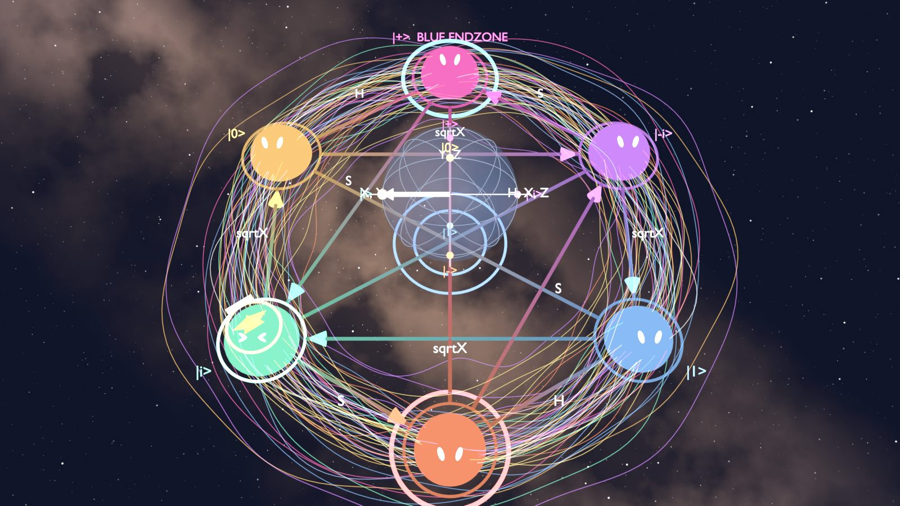
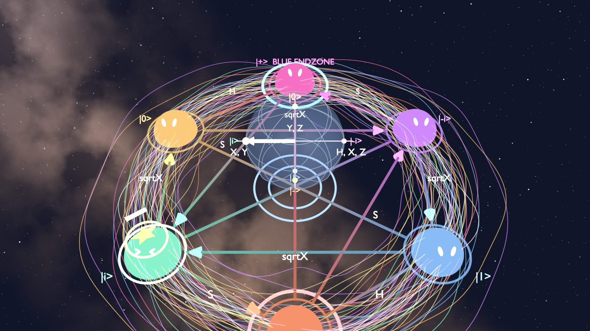
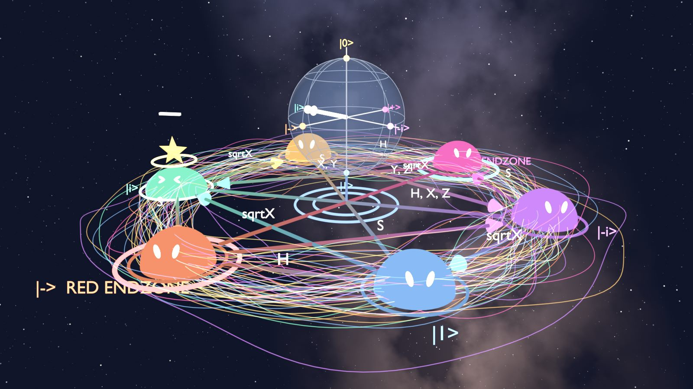

# Qubit Arena — Visual Design (space theme)

> How the game **looks and feels**. Game rules are in [rules.md](rules.md) and are not changed here.
> The look is taken from the team's Blender prototype (`reference/blender/qubit_touchdown.py`,
> "ORBIT" style). Rounds 4 (2D) and 5 (3D) in [claude-code-prompts.md](claude-code-prompts.md) build it.

| Overview | Goal view (Blue, toward \|+⟩) | Low cinematic |
|---|---|---|
|  |  |  |

*Rendered from the Blender prototype. The ball is the star token, resting on \|i⟩ (whose face shows "> <").*

## 1. Theme

**The board floats in deep space.** There is no table. Six cute glowing "dome" characters sit on a ring,
wrapped in a swirl of thin coloured orbit lines. A glass Bloch sphere hovers above the centre, all under a
starry Milky Way sky. The game should feel playful (characters, bounces, banners) while every number
and arrow on screen stays physically correct.

## 2. Board layout

* The six positions sit on a circle. **The end zones face each other like a football field:
  \|+⟩ (Blue) at the top, \|−⟩ (Red) at the bottom.**
* Going clockwise from the upper left, the order is \|0⟩, \|+⟩, \|−i⟩, \|1⟩, \|−⟩, \|i⟩. This is the
  rules.md §2.1 order, so the circle is the same; it is only rotated so the end zones are at the top and bottom.
* Use the engine, never hard-coded positions:
  * `boardPoint(position)` returns unit-circle coordinates (y up); scale them to the board radius.
    Blender uses a path radius of 4.6 and a dome radius of 0.72.
  * `BOARD_ANGLE_DEG` gives the angles: \|+⟩ 90°, \|−i⟩ 30°, \|1⟩ −30°, \|−⟩ −90°, \|i⟩ −150°, \|0⟩ 150°.
  * `boardEdges()` gives the **13 edges**: one per pair of positions, carrying every gate that uses it.
    * 5 two-way lines: \|0⟩↔\|1⟩ "X, Y", \|+⟩↔\|−⟩ "Y, Z", \|i⟩↔\|−i⟩ "H, X, Z", \|0⟩↔\|+⟩ "H", \|1⟩↔\|−⟩ "H".
    * 8 one-way arrows, labelled "S" or "√X".

### Colours

State colours come from the prototype. Its values are linear emission colours, so they render brighter
and more pastel than the hex values; tune them against the renders above.

| Position | Colour | Hex |
|---|---|---|
| \|0⟩ | orange | `#F79933` |
| \|+⟩ | magenta | `#ED298C` |
| \|−i⟩ | purple | `#9E40F5` |
| \|1⟩ | blue | `#4080EB` |
| \|−⟩ | red-orange | `#ED4A26` |
| \|i⟩ | green | `#40E699` |

| UI role | Hex |
|---|---|
| Gold accent (ball glow, Bloch tip, banners) | `#FFD14D` |
| Rim / beam | `#598CFF` |
| Text | `#F5F5FA` |
| Board base | `#04050A` |

* Team colours stay as in architecture.md §7.2: Blue `#1f5bd6`, Red `#c8323f`, accent cyan `#27e5f7`.
* In Team mode the end zone rings and labels use the team colour ("\|+⟩ BLUE ENDZONE", "\|−⟩ RED ENDZONE").

## 3. Board elements

| Element | Look | Behaviour |
|---|---|---|
| **Dome characters** (one per position) | Half-sphere in the state colour, two white oval eyes, glowing ring underneath. End zones get a second, brighter ring and a label. | Gentle floating bob, each with its own phase. Eyes blink every 2–5 s (sometimes a double blink) and drift slowly. **Everyone watches the ball while it flies.** When the ball lands on a character's head: "> <" eyes plus a bouncy squash (spring). |
| **Edges** | Thin tube with a colour gradient from one end's colour to the other. One-way edges have a cone arrowhead in the target colour. Gate label in the middle; lines through the centre are labelled near one end. | Edges that start at the ball's position **and** can be played from the current hand glow brighter. The ring under the ball glows brightest. |
| **Orbit swirl** | About 57 thin closed loops around the ring radius, wobbling in and out and up and down, in the six state colours plus white, gold and rim blue. | Three layers rotate at different speeds (1.0, −0.6, 1.5) with a slow brightness pulse. Brightness and opacity are adjustable in Settings. |
| **Ball token** | Brown football with white laces and a gold glow ring under it. Cosmetic options (per player): heart, star. | Hidden until the first kickoff. Rests on top of a dome. Idle animation: the football rocks gently, the heart beats, the star sways and twinkles. |
| **Bloch sphere** | Transparent blue glass sphere floating above the centre: latitude/longitude grid, x/y/z axes, six coloured dots with labels. A white state vector with a gold tip. A thin beam and a double ring "pad" link it to the board. | Its +x (\|+⟩) axis points at the board's \|+⟩ so sphere and board read the same way. The vector animates together with the ball (§4). |
| **Sky** | Procedural deep space: two star layers (many faint, some bright) and a Milky Way band with dust lanes, a warm core and blue arms. | Static. A cheap skybox texture is fine on the web. |

### Our extension: partner qubit and fog

The Blender prototype has no CNOT, so this part is new design:

* **Partner sphere:** a second, smaller Bloch sphere beside the main one, labelled "partner", with a cyan
  accent (architecture.md §7.2). It starts at \|+⟩ at every kickoff.
* **Fog (ball entangled):**
  * The ball token is hidden and a slow nebula cloud covers the board centre.
  * The characters look around, confused.
  * Both Bloch vectors shrink to the centre (length 0) and pulse.
  * A glowing link joins the two spheres while they are entangled.
  * The state panel shows the 4 amplitudes (rules.md §4.4).
* **Leaving the fog:** a CNOT that undoes it or a Measure shrinks the cloud into the ball at its new position.

## 4. Animations (from engine events)

The client turns the engine's `log` / events into a queue of animations. Default speed is 1 s per move,
with a speed setting.

| Event | Banner (centre top) | Motion |
|---|---|---|
| `CARD_PLAYED` (gate) | `H:  \|0⟩ → \|+⟩` | Ball hops along an arc to the target (height 1.1; 0.35 if it stays), smoothstep easing. At the same time the Bloch vector **rotates about the gate's axis**: X about x by 180°, Y about y by 180°, Z about z by 180°, H about (x+z)/√2 by 180°, S about z by 90°, √X about x by 90°, I none. |
| `CARD_PLAYED` with `MEASURED` | `MEASUREMENT  P(0)=50%  P(1)=50%`, then `RESULT: \|1⟩` or `FAILED PUNT: stays at \|0⟩` | Ball shakes and the Bloch tip pulses, then the ball hops (high if it moved) while the vector slerps to the result. |
| `CARD_PLAYED` CNOT | `CNOT: ball enters the fog` / `leaves the fog → \|1⟩` / `phase kickback: partner → \|−⟩` | Fog in or out (§3). The vectors interpolate between the reduced Bloch vectors. |
| `TOUCHDOWN` | `TOUCHDOWN!  BLUE TEAM (P2)` | Ball bounces and spins on the end zone dome. |
| `KICKOFF` | `KICKOFF  (Blue)  die = 0` | Ball appears at the centre and makes a high hop (2.2) to \|0⟩ or \|1⟩. The partner vector resets to \|+⟩. |
| `OPENING_ROLL` | `BLUE ROLLS 5` … `TIE 3-3 — ROLL AGAIN` … `BLUE STARTS (5-2)` | Two dice in the team colours. |
| *(derived on the client)* ball moved into the other side's zone | `NO SCORE — Red's endzone` | — |
| *(derived on the client)* ball stayed in your own zone | `NO SCORE — must leave and re-enter` | — |
| `TIME_UP`, `CHALLENGE_STARTED`, `CHALLENGE_RESULT`, `GAME_OVER` | `TIME UP!`, `QUANTUM CHALLENGE!`, `BLUE: CORRECT!`, winner text | Banner only. |

Turn on **reduced motion** in Settings to stop the bob, the swirl and the idle animations. Moves still
animate, but shorter.

## 5. Camera (3D, round 5)

| View | Use |
|---|---|
| **Goal view** *(default online)* | Camera behind the opponent's end zone, looking at **your own** end zone, high enough that the Bloch sphere does not hide it. Blue looks toward \|+⟩, Red toward \|−⟩, so your goal is always "up". |
| Overview | From the \|−⟩ side, high (prototype camera at (0, −8, 17)). |
| Top | Straight down, \|+⟩ at the top. |
| Ball cam | Behind the ball, looking toward the active player's goal. |
| Low cinematic | Low corner shot for menus, the result screen and demo videos. |

In 2D (round 4) use the top view, rotated so the **viewer's own end zone is at the top** (Blue: \|+⟩ up;
Red: \|−⟩ up). Spectators see Blue's orientation.

## 6. Controls and HUD

* **Hand:** the player's 4 cards along the bottom.
  * Selecting a card **previews** its destination. The card shows `H → \|+⟩`, the target dome glows and the
    edge lights up (computed with the shared engine, rules.md §6.1 step 2).
  * Measure shows `→ \|0⟩/\|1⟩ 50 %`, or `failed punt` at \|0⟩/\|1⟩.
  * Confirm with **Play Card**.
* **Arrow keys** (optional shortcut from the prototype): ↑ ↓ ← → plays a card from your hand whose edge
  points that way on screen, following the current camera. "Up" in goal view means "toward my end zone".
  The shortcut never picks I or Measure, needs a direction within ~70° (dot > 0.3), and shows its
  options ("↑ \|+⟩ (H)"). It only sends a normal `PLAY_CARD` intent, so it cannot break a rule.
* **HUD** (layout from architecture.md §7.2):
  * Score panel per side with its end zone ("BLUE (+ endzone): 2").
  * Turn indicator, target score, game clock and turn timer, draw-pile count.
  * State panel: \|ψ⟩ = α\|0⟩ + β\|1⟩, P(0) = \|α\|², P(1) = \|β\|², the Bloch (x, y, z), and the note
    "global phase does not move the ball" when a phase is shown.
  * A **minimap** (small flat board with the ball) in the top-left corner of 3D views.
  * The banner (§4) in the top centre.

## 7. Settings (client only, per player)

* Ball shape: football, heart or star.
* Animation speed.
* Swirl brightness and opacity.
* Camera view.
* Reduced motion.
* Show or hide gate labels.

None of these affect the game state.

## 8. Not taken from the prototype

| Prototype feature | Why it is not used |
|---|---|
| Borrow card | Not in rules.md (team decision, 11 Nov 2026: CNOT only). |
| Solo with no target or time limit | rules.md §5 defaults apply. |
| Interactive kickoff and dice buttons | The server rolls everything (rules.md §10). The dice are shown as animations only. |
| One-computer hand panel | Online play hides opponents' hands (rules.md §9). |
| HDRI import, debug and self-test panels, legacy-object cleanup | Blender-only tooling. |
